<!--
  Custom animated profile README.
  Project facts and technologies are taken from the public repositories linked below.
-->

  <picture>
    <source media="(prefers-color-scheme: dark)" srcset="assets/profile-light.svg">
    <source media="(prefers-color-scheme: light)" srcset="assets/profile-dark.svg">
    
  </picture>

   

  
  
  

  

---

## `01 / ABOUT`

**Software Engineer**

This profile collects my public projects, experiments, and learning work. Browse the repositories below to see the code and the project-specific documentation.

  
  

## `02 / FEATURED PUBLIC PROJECTS`

<table>
  <tr>
    <td width="50%" valign="top">

### <a href="https://github.com/Ossamahendi21/fashion-SAAS">Fitcheck · fashion-SAAS</a>

**AI wardrobe & virtual try-on**

A full-stack wardrobe experience described in the repository: organize clothing, explore outfit combinations, and preview looks with image-based workflows.

`Next.js` · `React` · `TypeScript` · `Tailwind CSS` · `Clerk` · `Convex`

[Repository](https://github.com/Ossamahendi21/fashion-SAAS) · [Demo link in repository README](https://fitcheck-eight-black.vercel.app)

</td>
    <td width="50%" valign="top">

### <a href="https://github.com/Ossamahendi21/ClipNova-progect-">ClipNova</a>

**AI content repurposing concept**

A project in development that aims to help transform long-form video and audio into short clips, with a React frontend and a Flask/PostgreSQL backend foundation.

`React` · `Tailwind CSS` · `Flask` · `PostgreSQL` · `Docker`

[Explore the repository](https://github.com/Ossamahendi21/ClipNova-progect-)

</td>
  </tr>
  <tr>
    <td width="50%" valign="top">

### <a href="https://github.com/Ossamahendi21/zenflow-ai-">ZenFlow AI</a>

**Productivity & life-organization concept**

A project foundation for an AI-assisted productivity experience. Its README describes planned features for organizing tasks, prioritization, and personal insights.

`React` · `Tailwind CSS` · `Flask` · `PostgreSQL` · `OpenAI`

[Explore the repository](https://github.com/Ossamahendi21/zenflow-ai-)

</td>
    <td width="50%" valign="top">

### <a href="https://github.com/Ossamahendi21/printf">printf · C</a>

**Low-level programming**

A collaborative C project implementing a simplified version of the `printf` function and formatted-output conversion specifiers.

`C` · `Variadic functions` · `Formatted output`

[Explore the repository](https://github.com/Ossamahendi21/printf)

</td>
  </tr>
</table>

## `03 / TECHNOLOGIES IN MY PUBLIC PROJECTS`

  

  
<strong>Where they appear</strong>

  - **Web:** JavaScript, TypeScript, HTML, CSS, React, Next.js, Tailwind CSS, Bootstrap.
  - **Backend and data:** Python, Flask, PostgreSQL, Docker.
  - **Programming practice and tools:** C, Git, GitHub.
  - **Project integrations:** Clerk, Convex, OpenAI, as listed in the Fitcheck and ZenFlow AI READMEs.

  These are technologies named in the linked public repository documentation; this list is not a claim of equal depth or professional experience with every item.

## `04 / MORE PUBLIC REPOSITORIES`

| Repository | Open |
|---|---|
| `alx-low_level_programming` | [View source](https://github.com/Ossamahendi21/alx-low_level_programming) |
| `alx-system_engineering-devops` | [View source](https://github.com/Ossamahendi21/alx-system_engineering-devops) |
| `alx-pre_course` | [View source](https://github.com/Ossamahendi21/alx-pre_course) |
| `alx-zero_day` | [View source](https://github.com/Ossamahendi21/alx-zero_day) |
| `zero_day` | [View source](https://github.com/Ossamahendi21/zero_day) |
| `fooocus_colab` | [View source](https://github.com/Ossamahendi21/fooocus_colab) |
| `Ossamahendi212` | [View source](https://github.com/Ossamahendi21/Ossamahendi212) |

  <a href="https://github.com/Ossamahendi21?tab=repositories"><strong>VIEW ALL PUBLIC REPOSITORIES →</strong></a>

## `05 / GITHUB ACTIVITY`

  
  

  

Activity cards use live data from GitHub through external rendering services; availability may vary.

---

## `06 / CONNECT`

  
  
  
  
  

### Build. Learn. Repeat.

Thanks for visiting my profile.

